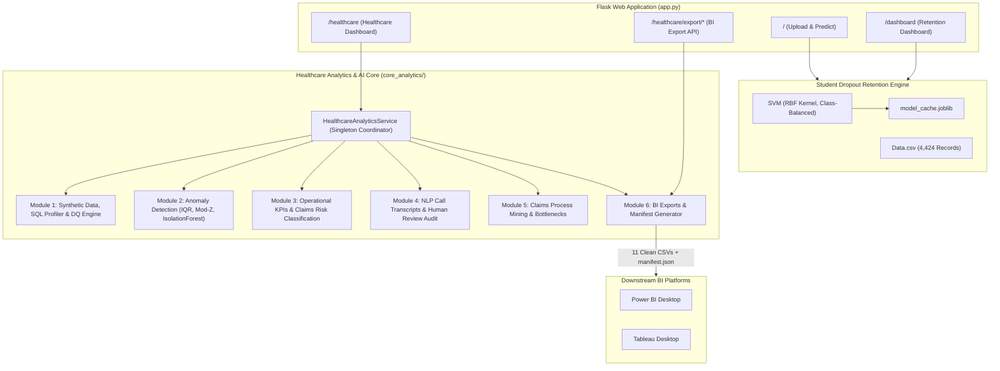

# Student Dropout Prediction & Healthcare Analytics System

A dual-domain predictive analytics and business intelligence platform built on Flask, Scikit-Learn, and Python.

This project combines:
1. **Higher Education Retention**: An SVM classification system predicting student dropout risk from early-semester academic and socioeconomic indicators.
2. **Healthcare Operations & AI**: An operational analytics engine, claims rejection-risk model, process mining analyzer, NLP call audit pipeline, and BI-ready export framework designed for health plans.

---

## Architecture Overview



---

## Key Modules Summary

| Module | Core Responsibility | Key Technologies | Primary Outputs |
| :--- | :--- | :--- | :--- |
| **Student Retention** | Student dropout classification & diagnostic risk remarked reports | Scikit-Learn (SVM), Joblib, Pandas | 83.6% accuracy, 73.9% recall, Excel reports |
| **Module 1: Healthcare Data & DQ** | Deterministic synthetic healthcare dataset generator & SQL profiling | SQLite, Pandas, SQL profiling | `claims`, `members`, `providers` tables, 9 DQ checks |
| **Module 2: Anomaly Detection** | Statistical and machine learning anomaly detection on financial claims | IQR Tukey fences, Modified Z-score (MAD), Isolation Forest | Anomaly scores, record flags, feature-level attribution |
| **Module 3: Claims & Risk AI** | Operational KPIs, PMPM expenditure, and pre-adjudication rejection risk | Scikit-Learn Pipeline, ColumnTransformer, RandomForest | Billed/paid spend, denial rate %, PMPM, rejection risk tiers |
| **Module 4: NLP & Human Review** | Extraction of structured entities from call transcripts & audit trail | Regex, TF-IDF + LogisticRegression, SQLite Audit Table | Intent classification, claim ID extraction, reviewer audit log |
| **Module 5: Process Mining** | Adjudication workflow event mining, rework loops, bottlenecks | Markovian transitions, Pandas, NumPy | Case cycle times, variant taxonomy, delay bottlenecks |
| **Module 6: Dashboard & BI Exports** | Healthcare dashboard UI, REST summary API, BI CSV export bundle | Flask, Tailwind CSS, Chart.js, Zipfile | `/healthcare`, 11 CSV exports, `manifest.json`, ZIP bundle |
| **Module 7: QA & Validation** | Full-suite regression testing, data leakage audit, reconciliation | Pytest (78 tests), Git audit, validation guides | Complete test verification, interview preparation notes |

---

## Quick Start & Installation

### 1. Clone Repository & Setup Virtual Environment
```bash
# Clone the repository
git clone https://github.com/Aditya-Agarwal86/Student-Dropout-Predictor.git
cd Student-Dropout-Predictor

# Create and activate virtual environment
python -m venv venv
# On Windows:
venv\Scripts\activate
# On Linux/macOS:
source venv/bin/activate

# Install dependencies
pip install -r requirements.txt
```

### 2. Verify Setup
```bash
python setup.py
```

### 3. Run Automated Tests
```bash
# Run all 78 unit and integration tests
python -m pytest

# Run ML pipeline benchmark
python test_ml.py
```

### 4. Start Flask Application
```bash
python app.py
```
Open `http://localhost:5000` in your browser.

---

## Walkthrough: Demonstrating the Application

1. **Student Dropout Prediction Portal**:
   - Navigate to `http://localhost:5000/`.
   - Download the pre-formatted dataset via **Download Sample CSV**.
   - Upload the file to inspect the interactive retention dashboard, risk bands, and per-student diagnostic remarks.
2. **Healthcare Analytics & AI Dashboard**:
   - Navigate to `http://localhost:5000/healthcare`.
   - Review operational claims KPIs, denial rate, PMPM spending, and data-quality health.
   - Inspect the Machine Learning rejection-risk distribution donut chart (Low / Medium / High).
   - Review process mining variants and statistical workflow bottleneck transitions.
3. **Power BI / Tableau BI Export Downloads**:
   - Click **"Export BI Bundle (.zip)"** or download individual CSV tables.
   - Refer to `core_analytics/BI_DASHBOARD_GUIDE.md` for star-schema relationship diagrams, DAX formulas, and Tableau LOD calculations.

---

## Responsible AI & Demonstration Limitations

1. **Synthetic Healthcare Data**: All member IDs, provider profiles, claims, event logs, and transcripts are generated with fixed random seeds for demonstration. No protected health information (PHI) is used.
2. **Prototype Scope**: Statistical outlier flags (IQR, Isolation Forest) indicate unusual records requiring review—they do not constitute proof of fraud or abuse.
3. **Target Leakage Prevention**: In the claims rejection model, post-adjudication features (`claim_status`, `denial_reason`, `paid_amount`) are excluded from pre-adjudication risk scoring.
