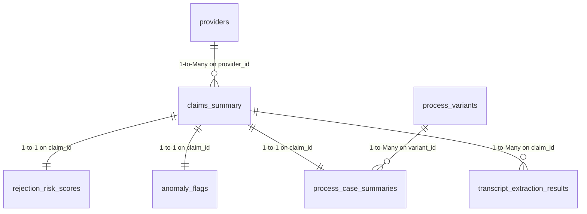

# Power BI & Tableau Implementation Guide: Healthcare Operational Analytics

## Executive Overview
This guide provides complete instructions for importing the BI-ready CSV export tables generated by `core_analytics.exports.bi_export_generator` into **Power BI** or **Tableau Desktop**. 

The analytics data bundle models an end-to-end healthcare claims operations environment for HealthPlans.ai, integrating:
- Claims settlement and denial KPIs (Module 3)
- Provider operational scorecards (Module 3)
- Machine Learning pre-adjudication claim rejection-risk scores (Module 3)
- Automated data-quality rule audits and severity indicators (Module 1)
- Statistical high-cost anomaly flags (Module 2)
- Natural language call transcript entity extraction and human-review audits (Module 4)
- Process mining cycle times, rework loops, and operational bottleneck paths (Module 5)

> [!IMPORTANT]
> **Data Nature & Notice**: All exported records are **synthetic demo data** generated using deterministic random seeds (Seed: 42) for internship demonstration purposes. No protected health information (PHI) is present. Anomaly flags reflect statistical Tukey/IQR deviations requiring review—not proof of fraud.

---

## 1. Export Bundle Architecture & Table Grain

The BI export bundle comprises 11 CSV tables and 1 JSON metadata manifest (`manifest.json`):

| File Name | Grain | Primary Key | Recommended BI Role | Description |
| :--- | :--- | :--- | :--- | :--- |
| **`claims_summary.csv`** | 1 row per unique claim | `claim_id` | **Fact Table** | Core claims fact containing billed, paid, and settlement outcomes. Deduplicated by `claim_id`. |
| **`provider_analytics.csv`** | 1 row per provider | `provider_id` | **Dimension Table** | Provider operational scorecard, specialty, claim volume, and denial rates. |
| **`denial_breakdown.csv`** | 1 row per denial reason | `denial_reason` | **Aggregate Fact** | High-level denial frequencies and financial impact for Pareto charts. |
| **`rejection_risk_scores.csv`**| 1 row per evaluated claim | `claim_id` | **Fact Extension** | Pre-adjudication ML model predicted rejection probability and risk bands (`Low`, `Medium`, `High`). |
| **`anomaly_flags.csv`** | 1 row per evaluated claim | `claim_id` | **Fact Extension** | Statistical outlier scores and flags based on Tukey's IQR fences ($k=1.5$). |
| **`data_quality_results.csv`** | 1 row per validation rule | `rule_name` | **Audit Dimension** | Automated quality test results, severity levels (`CRITICAL`, `WARNING`), and affected record counts. |
| **`transcript_extraction_results.csv`** | 1 row per call transcript review | `transcript_id` | **Audit Fact** | NLP extracted member intents, extracted claim IDs, and human auditor review decisions. |
| **`process_case_summaries.csv`** | 1 row per workflow case | `claim_id` | **Process Fact** | Process mining cycle times (days), event counts, rework flags, and supervisor override flags. |
| **`process_variants.csv`** | 1 row per execution path | `variant_id` | **Process Dimension**| Workflow path taxonomy, case volume, share percentage, and median cycle times. |
| **`process_transitions.csv`** | 1 row per directed activity edge | `(source_activity, target_activity)` | **Network Matrix** | Markovian activity transition frequencies and duration statistics (mean/median days). |
| **`process_bottlenecks.csv`** | 1 row per bottleneck edge | `(source_activity, target_activity)` | **Alert Table** | Statistical delay candidates exceeding $1.0\sigma$ operational baseline duration. |

---

## 2. Recommended Data Model & Relationships (Star Schema)

When importing into Power BI (Model View) or Tableau (Data Model Relationships):



### Relationship Configuration Rules:
1. **`provider_analytics` (1) to `claims_summary` (\*)**:
   - Relationship: **1-to-Many (`1:*`)**
   - Cross-filter direction: **Single** (`provider_analytics` filters `claims_summary`).
2. **`claims_summary` (1) to `rejection_risk_scores` (1)**:
   - Relationship: **1-to-1 (`1:1`)** or 1-to-Many where `rejection_risk_scores` acts as an extension dimension.
   - Cross-filter direction: **Both**.
3. **`claims_summary` (1) to `anomaly_flags` (1)**:
   - Relationship: **1-to-1 (`1:1`)**.
4. **`claims_summary` (1) to `process_case_summaries` (1)**:
   - Relationship: **1-to-1 (`1:1`)**.
5. **Stand-alone Tables**:
   - `data_quality_results.csv`, `denial_breakdown.csv`, `process_transitions.csv`, and `process_bottlenecks.csv` can remain disconnected for dedicated summary cards, matrix heatmaps, and audit monitors.

---

## 3. Key Calculated Measures & DAX / Tableau Formulas

### A. Power BI (DAX Formulas)

```dax
// 1. Total Billed and Paid Spend
Total Billed Spend = SUM(claims_summary[billed_amount])
Total Paid Spend = SUM(claims_summary[paid_amount])

// 2. Operational Denial Rate (%)
Total Claims = COUNTROWS(claims_summary)
Denied Claims = CALCULATE(COUNTROWS(claims_summary), claims_summary[claim_status] = "Denied")
Denial Rate % = DIVIDE([Denied Claims], [Total Claims], 0) * 100

// 3. Clean Claim Rate (%)
Paid Claims = CALCULATE(COUNTROWS(claims_summary), claims_summary[claim_status] = "Paid")
Clean Claim Rate % = DIVIDE([Paid Claims], [Total Claims], 0) * 100

// 4. High Risk Claims Count (ML Model Prediction)
High Risk Claims Count = 
CALCULATE(
    COUNTROWS(rejection_risk_scores), 
    rejection_risk_scores[predicted_risk_band] = "High"
)

// 5. Workflow Rework Rate (%)
Rework Cases = CALCULATE(COUNTROWS(process_case_summaries), process_case_summaries[has_rework] = TRUE())
Total Process Cases = COUNTROWS(process_case_summaries)
Rework Rate % = DIVIDE([Rework Cases], [Total Process Cases], 0) * 100

// 6. Average Adjudication Cycle Time (Days)
Avg Cycle Time Days = AVERAGE(process_case_summaries[cycle_time_days])
```

### B. Tableau (Calculated Fields / LODs)

- **Denial Rate**:
  ```tableau
  SUM(IIF([Claim Status] = 'Denied', 1, 0)) / COUNT([Claim Id])
  ```
- **Reimbursement Rate**:
  ```tableau
  SUM([Paid Amount]) / SUM([Billed Amount])
  ```
- **High Risk Flag Indicator**:
  ```tableau
  IF [Predicted Risk Band] = 'High' AND [Actual Observed Status] = 'Paid' THEN 'High Risk Override'
  ELSEIF [Predicted Risk Band] = 'High' AND [Actual Observed Status] = 'Denied' THEN 'High Risk True Denial'
  ELSE 'Standard Adjudication'
  END
  ```
- **Provider Denial Benchmark (LOD)**:
  ```tableau
  { FIXED [Specialty] : AVG([Denial Rate %]) }
  ```

---

## 4. Visual Dashboard Layout & Recommended Visuals

Build a 4-tab executive operations report:

### Page 1: Claims Operational Overview & Financial Performance
- **Executive Card Banner**: Total Billed, Total Paid, Denial Rate %, Clean Claim Rate %, and Average Cycle Time.
- **Visual 1 (Donut Chart)**: Settlement Distribution by `claim_status` (`Paid`, `Denied`, `In Process`, `Pending`).
- **Visual 2 (Pareto Bar Chart)**: Denials by `denial_reason` sorted descending with cumulative percentage line.
- **Visual 3 (Scatter Plot)**: Provider Billing vs. Denial Rate with bubble size representing total claim volume.

### Page 2: AI Risk Scoring & Anomaly Detection Monitor
- **Visual 1 (Stacked Bar / Donut)**: Distribution of `predicted_risk_band` (`Low`, `Medium`, `High`).
- **Visual 2 (Confusion Matrix / Heatmap)**: Cross-tabulation of `predicted_risk_band` vs. `actual_observed_status`.
  - Highlights *model sensitivity* and operational interventions.
- **Visual 3 (Table / Alert Grid)**: Statistical Outliers from `anomaly_flags.csv`.
  - Filtered to `is_anomaly = True`. Include disclaimer: *"Statistical High-Cost Outlier for Audit Review"*.

### Page 3: Process Mining & Workflow Delays
- **Visual 1 (Horizontal Bar)**: Top Process Variants from `process_variants.csv` by `case_count` with `avg_cycle_time_days` as tooltip.
- **Visual 2 (Matrix Heatmap)**: `process_transitions.csv` with `source_activity` on rows, `target_activity` on columns, and values colored by `mean_duration_days`.
- **Visual 3 (Callout Table)**: `process_bottlenecks.csv` highlighting transitions where delay $> 1.0\sigma$.

### Page 4: Data Quality & Call Review Governance
- **Visual 1 (Gauge / KPI Cards)**: Overall DQ Pass Rate %, Critical Violations Count.
- **Visual 2 (Grid Table)**: `data_quality_results.csv` listing `rule_name`, `severity`, `passed`, and `affected_records`.
- **Visual 3 (Audit Review Grid)**: `transcript_extraction_results.csv` showing `transcript_id`, `predicted_intent`, `reviewer_id`, `review_status`, and `reviewer_comments`.

---

## 5. Recommended Slicers and Filters
- **Date Range Slicer**: `service_start_date` (Year / Quarter / Month).
- **Plan Type Filter**: Commercial, Medicare Advantage, Medicaid.
- **Claim Type Filter**: Professional, Institutional, Pharmacy, Dental.
- **Provider Specialty Filter**: Family Practice, Internal Medicine, Cardiology, Orthopedics.
- **Risk Band Slicer**: Low, Medium, High.
- **Rework & Override Filters**: Rework Present (`Yes`/`No`), Override Present (`Yes`/`No`).

---

## 6. How to Refresh and Generate Data
You can refresh or recreate the export package at any time:

### Via Command-Line:
```powershell
python -m core_analytics.exports.bi_export_generator
```
Files will be placed in `core_analytics/exports/output/`.

### Via Web Application:
1. Start Flask: `python app.py`
2. Navigate to `http://localhost:5000/healthcare`
3. Click **"Export BI Bundle (.zip)"** to download the complete archive.
4. Unzip into your project's local data directory and click **Refresh** in Power BI Desktop or Tableau.

---

## 7. Limitations & Ethical Analytics Guardrails
1. **Synthetic Nature**: All distributions (bimodal denial rates, log-normal billed amounts, Markov workflow steps) are generated programmatically for demonstration purposes.
2. **Model Independence**: The claim rejection-risk model is evaluated purely on pre-adjudication features; observed settlement statuses reflect synthetic policy decisions.
3. **No Unwarranted Fraud Claims**: Outliers identified by IQR or Isolation Forest represent mathematical extremes requiring clinical/coding review; they do not substantiate fraud or abuse.
